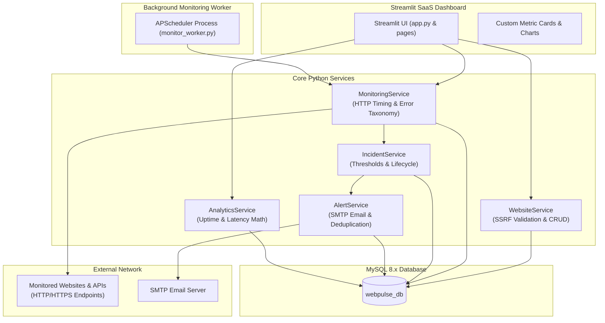
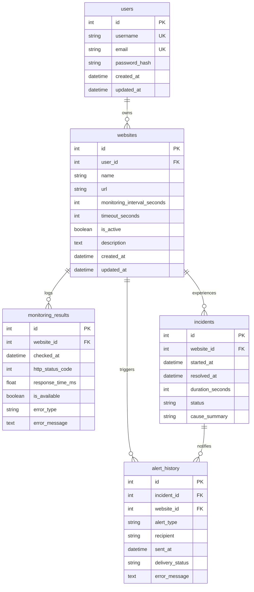

# WebPulse — Website Availability and Downtime Monitoring Platform

[](https://www.python.org/)
[](https://www.mysql.com/)
[](https://flask.palletsprojects.com/)
[](https://www.sqlalchemy.org/)
[](https://apscheduler.readthedocs.io/)
[](https://docs.pytest.org/)

WebPulse is an enterprise-grade website availability, latency telemetry, and downtime observability platform built in Python with MySQL. It continuously monitors registered web applications and APIs, measures millisecond response times, categorizes HTTP and network failure modes, calculates multi-period availability percentages, manages incident lifecycles, and delivers a professional SaaS dashboard.

---

## 1. Problem Statement & Architecture

Modern cloud applications require continuous synthetic monitoring to detect outages, degradation, and SSL certificate expiration before users are impacted. Basic ping scripts lack historical telemetry, fail to handle HTTP redirects or SSL handshakes, and often classify temporary network jitters as major outages.

**WebPulse** solves this through a decoupled, multi-process architecture:
- **Independent APScheduler Worker**: Operates continuously in the background, executing non-blocking HTTP checks with configurable polling intervals per website.
- **Flask + Bootstrap 5 Dashboard**: High-performance, professional SaaS dashboard (`webapp.py`) with Chart.js telemetry charts, responsive modals, status badges, incident feeds, and clean RESTful design. (Streamlit interface also available via `app.py`).
- **MySQL 8.x Persistent Storage**: High-performance normalized database schema with indexed timestamp querying, connection pooling, and cascading integrity.

### System Architecture Flow



---

## 2. Main Features

- **Actual HTTP Telemetry**: Executes real HTTP requests using Python's `requests` library. Follows redirects (3xx), enforces TLS/SSL verification, and records high-precision millisecond latency.
- **Granular Error Taxonomy**: Differentiates between:
  - Operational responses (HTTP 2xx, 3xx)
  - HTTP 4xx Client Errors (`HTTP_404_CLIENT_ERROR`, etc.)
  - HTTP 5xx Server Errors (`HTTP_500_SERVER_ERROR`, etc.)
  - Connection Timeouts (`CONNECTION_TIMEOUT`)
  - Read Timeouts (`READ_TIMEOUT`)
  - DNS Resolution Failures (`DNS_ERROR`)
  - Connection Refusal (`CONNECTION_REFUSED`)
  - SSL/TLS Certificate Failures (`SSL_ERROR`)
- **Consecutive Failure Thresholds**: Avoids false alarms from single network blips. Requires $N$ consecutive failed checks (default: 2) before opening a downtime incident.
- **Incident Lifecycle Management**: Tracks incident start time, active duration, root cause summary, and automatically transitions to `RESOLVED` with total downtime calculation upon operational recovery.
- **Uptime Analytics**: Calculates uptime percentages over 24-hour, 7-day, and 30-day windows:
  $$\text{Uptime \%} = \frac{\text{Successful Monitoring Checks}}{\text{Total Valid Monitoring Checks}} \times 100$$
  Displays "No data" instead of deceptive 100% when no checks exist.
- **SSRF Network Defense**: Validates registered targets to prevent Server-Side Request Forgery. Blocks loopback interfaces (`127.0.0.1`, `localhost`, `::1`), RFC 1918 private subnets (`10.0.0.0/8`, `172.16.0.0/12`, `192.168.0.0/16`), link-local IPs, and cloud metadata endpoints (`169.254.169.254`).
- **Configurable Email Notifications**: Dispatches automated downtime alerts when incidents open and recovery notices when operational status returns. Includes deduplication and delivery audit logging.
- **Professional UI/UX**: Custom design system featuring a dark navy sidebar, clean neutral dashboard, SaaS KPI cards, Plotly charts, and responsive status pills.

---

## 3. Database Schema Design (MySQL 8.x)



The database includes indexes on `(website_id, checked_at)`, `(is_available, checked_at)`, and `(website_id, status)` to ensure fast analytical queries over large datasets.

---

## 4. Technology Stack

| Layer | Technologies |
|---|---|
| **Frontend UI** | Streamlit, Custom CSS Design System, Plotly Express & Graph Objects |
| **Backend Logic** | Python 3.12, Requests, Pydantic, python-dotenv |
| **Database & ORM** | MySQL 8.x, SQLAlchemy 2.0 (with connection pooling), PyMySQL |
| **Scheduling** | APScheduler (Advanced Python Scheduler) |
| **Testing** | pytest (Mocked requests, isolated in-memory DB fixtures) |

---

## 5. Local Setup & Execution (Windows PowerShell)

Follow these steps to set up and run WebPulse on Windows:

### Step 1: Verify Python Version
```powershell
python --version
# Expected: Python 3.12.x
```

### Step 2: Navigate to Project Directory
```powershell
cd C:\Projects\webpulse
```

### Step 3: Activate the Virtual Environment
```powershell
# Set execution policy if necessary:
# Set-ExecutionPolicy -ExecutionPolicy RemoteSigned -Scope Process

.\.venv\Scripts\Activate.ps1
```

### Step 4: Configure Environment Variables (`.env`)
A `.env` file is present in the project directory. Edit `.env` with your MySQL credentials:
```ini
DB_HOST=127.0.0.1
DB_PORT=3306
DB_USER=root
DB_PASSWORD=your_mysql_password
DB_NAME=webpulse_db

# Monitoring Defaults
DEFAULT_INTERVAL_SECONDS=60
DEFAULT_TIMEOUT_SECONDS=10
FAILURE_THRESHOLD=2
SLOW_RESPONSE_THRESHOLD_MS=1500

# Email Alerts (Optional SMTP)
SMTP_ENABLED=false
SMTP_HOST=smtp.gmail.com
SMTP_PORT=587
SMTP_USER=
SMTP_PASSWORD=
ALERT_RECIPIENT=
```
> **Zero-Config Testing Note**: If MySQL is not configured or credentials are unset, WebPulse automatically provides an intelligent fallback to local SQLite (`webpulse.db`) so you can explore and demonstrate the dashboard immediately.

### Step 5: Initialize Database Schema & Seed Data
Initialize all database tables and seed initial production verification targets (`example.com`, `python.org`, `github.com`):
```powershell
python -m database.init_db
```

### Step 6: Launch the WebPulse Dashboard
```powershell
python webapp.py
```
The dashboard will open at `http://127.0.0.1:5000`.

### Step 7: Start Background Monitoring Worker (Separate Terminal)
Open a new PowerShell terminal and run:
```powershell
cd C:\Projects\webpulse
.\.venv\Scripts\Activate.ps1
python -m workers.monitor_worker
```
The worker will continuously poll active targets, execute HTTP requests, evaluate thresholds, and persist results to the database.

---

## 6. Running Automated Tests

WebPulse comes with a comprehensive pytest test suite covering validation, SSRF defenses, HTTP mock responses, consecutive failure thresholds, and uptime math:

```powershell
pytest -v tests
```

Output:
```text
============================= test session starts =============================
collected 15 items

tests/test_analytics.py::test_uptime_calculation_math PASSED             [  6%]
tests/test_analytics.py::test_analytics_empty_dataset_handling PASSED    [ 13%]
tests/test_incidents.py::test_incident_lifecycle_and_threshold PASSED    [ 20%]
tests/test_monitoring.py::test_monitoring_successful_200 PASSED          [ 26%]
tests/test_monitoring.py::test_monitoring_redirect_301_operational PASSED [ 33%]
tests/test_monitoring.py::test_monitoring_client_error_404 PASSED        [ 40%]
tests/test_monitoring.py::test_monitoring_server_error_500 PASSED        [ 46%]
tests/test_monitoring.py::test_monitoring_connect_timeout PASSED         [ 53%]
tests/test_monitoring.py::test_monitoring_ssl_error PASSED               [ 60%]
tests/test_monitoring.py::test_monitoring_dns_error PASSED               [ 66%]
tests/test_validation.py::test_valid_urls PASSED                         [ 73%]
tests/test_validation.py::test_reject_unsupported_schemes PASSED         [ 80%]
tests/test_validation.py::test_ssrf_rejects_localhost_and_loopback PASSED [ 86%]
tests/test_validation.py::test_ssrf_rejects_private_ips_and_cloud_metadata PASSED [ 93%]
tests/test_validation.py::test_registration_validation_thresholds PASSED [100%]

============================= 15 passed in 0.68s ==============================
```

---

## 7. Troubleshooting Guide

- **MySQL Connection Error (`Access denied for user 'root'@'localhost'`):**
  Ensure the `DB_PASSWORD` in `.env` matches your local MySQL installation. WebPulse will fall back to SQLite if credentials are missing or invalid so you can test without interruption.
- **Port 8501 in use:**
  Run `python webapp.py --server.port 8502`.
- **Worker Not Polling:**
  Ensure `python -m workers.monitor_worker` is running in its own terminal. Active websites must have `is_active = True`.
- **Target URL Validation Failed:**
  URLs must start with `http://` or `https://` and point to public domains. Loopback addresses (`localhost`, `127.0.0.1`) are intentionally blocked for security.

---

## 8. License

Developed as a modern observability demonstration project. Open source under the MIT License.
